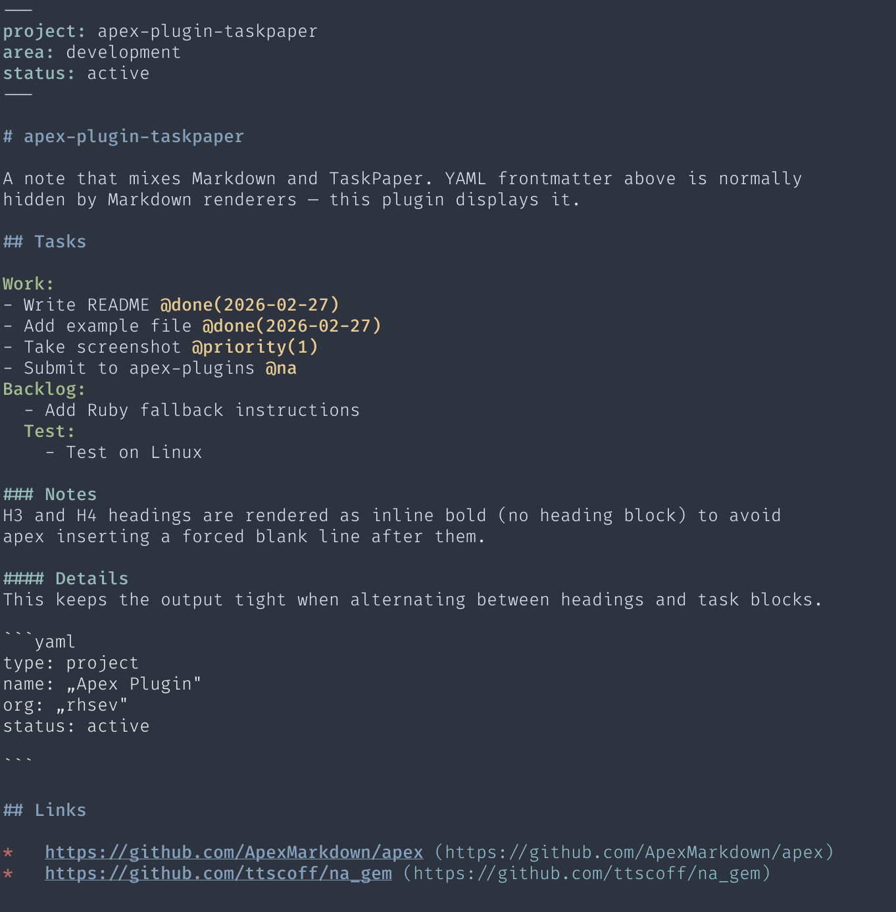

# apex-plugin-taskpaper

An [apex](https://github.com/ApexMarkdown/apex) `pre_parse` plugin for using TaskPaper task management inside Markdown files.

## The idea

Markdown is a suitable format to manage notes, tasks and data. Tasks are managed with [na](https://github.com/ttscoff/na_gem) (Brett Terpstra's next-action tool). TaskPaper-style tasks live right inside the note files, indented with tabs under a project header. This works well for `na`, but Markdown interprets tab-indented content as code blocks. 

This plugin teaches apex to read that structure as intended: project headers stand out visually, tasks preserve their nesting level, and `@tags` are immediately recognizable. TaskPaper is rendered as plain text with hard line breaks. This keeps the output tight and the indentation intact.

YAML frontmatter, normally hidden by Markdown renderers, is displayed too, since the tool [grubber](https://github.com/rhsev/grubber) uses it alongside YAML code blocks as data sources.

## What it does

| Input | Output |
|---|---|
| `Project:` (line ending with `:`, optionally followed by `@tags`) | bold, class `h4text` |
| `\tSub Project:` (indented `:`) | bold, class `h4text`, indented |
| `\t- Task @done` | `- Task @done`, indented, `@done` colored |
| `### Section` / `#### Sub` | bold `\#\#\# Section`, class `h3text`, no heading block |
| `# Title` / `## Header` | real Markdown H1/H2, shown with their `#` marks |
| YAML frontmatter or MultiMarkdown metadata | `key: value` pairs, keys colored (class `fmkey`) |

H1/H2 stay real Markdown headings. H3/H4 are rendered as inline bold to avoid the blank line apex inserts after heading blocks, keeping them visually distinct without disrupting flow.

A line starting with `- ` is always a task, even when it ends with a colon; numbered or `+`/`*` lines such as `00. Inbox:` are projects. Tab- or space-indented `- ` lines directly under an ordinary top-level Markdown list item are left to apex as a nested list. Fenced code (```` ``` ```` and `~~~`) is never touched.

Only the file's own frontmatter keys are displayed: the apex CLI merges `config.yml` settings (e.g. `terminal.width`) into the frontmatter it hands to plugins, and the plugin drops those by comparing against the file in `APEX_FILE_PATH`. Input from stdin has no file to compare against, so everything is shown.

## Screenshot



## Example

See [`example.taskpaper.md`](example.taskpaper.md) in this repo.

## Theme configuration

Add `span_classes` to your apex terminal theme (e.g. `~/.config/apex/terminal/themes/mytheme.theme`):

```yaml
span_classes:
  h3text: b bright_cyan    # H3/H4 headings
  h4text: b bright_green   # project headers (all levels)
  atag:   b yellow         # @tags
  fmkey:  b cyan           # frontmatter keys
```

`b` = bold. Use with:

```bash
apex file.md --plugins -t terminal256 --theme mytheme
```

## Tags

The plugin wraps `@tag` and `@tag(value)` in a span with class `atag` on task and prose lines. As in TaskPaper, a tag starts a line or follows whitespace, so mail addresses and URL handles (`youtube.com/@name`) are left alone. Tags in inline code and in fenced code blocks stay as they are. Project and heading lines are styled as a whole, so their tags keep that line's style.

Earlier versions left this to a separate `atag` plugin. If `~/.config/apex/plugins/atag` exists, remove it, or tags inside code blocks still get wrapped.

## Requirements

- [apex](https://github.com/ApexMarkdown/apex) ≥ 0.1.83

No additional system libraries or compilers required. The `post_install` step downloads the pre-compiled macOS arm64 binary directly from the [latest GitHub Release](https://github.com/rhsev/apex-plugin-taskpaper/releases).

## Installation

```bash
apex --install-plugin https://github.com/rhsev/apex-plugin-taskpaper.git
```

To compile from source instead (requires Go ≥ 1.21), run manually after install:

```bash
cd ~/.config/apex/plugins/taskpaper
go build -o taskpaper_plugin taskpaper_plugin.go
```

## Limitations

- **Paragraph breaks inside a project block**: each project and its tasks form a single paragraph via hard line breaks. A blank line separates sections, which is usually the right behavior in TaskPaper, but it means you can't have multi-paragraph content within a project block.
- **Project depth**: nesting is shown as indentation at any depth, but all projects share one class (`h4text`), so they share one color.
- **Empty output**: apex replaces the document with whatever a plugin prints, whatever its exit status. If the binary is missing or cannot run (the release binary is macOS arm64 only), `apex --plugins` renders an empty page; build from source in that case.

## Implementation

The plugin is written in Go and compiled to a static native binary with no external dependencies. Performance (hyperfine, on this machine):

```
apex file.md --plugins   →  ~26 ms
apex file.md             →  ~11 ms
```

The ~15 ms overhead is Inter-Process Communication, not the transformation itself.

## License

MIT
